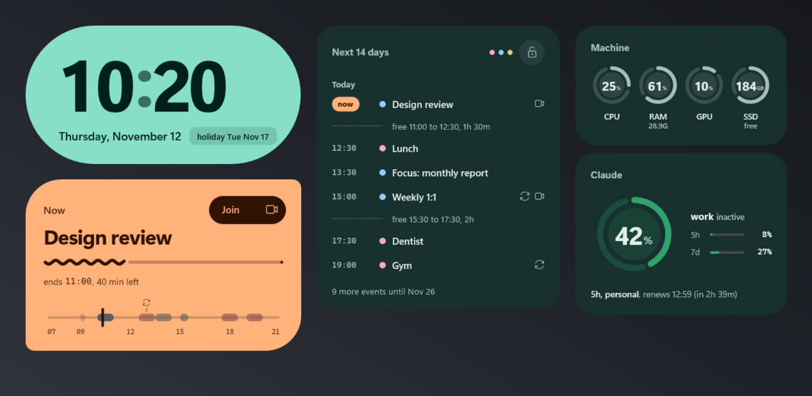
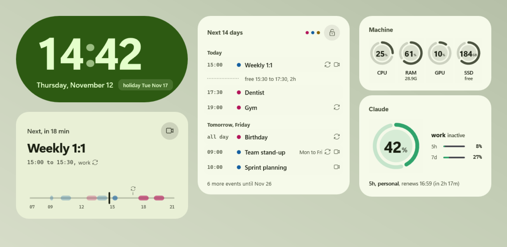
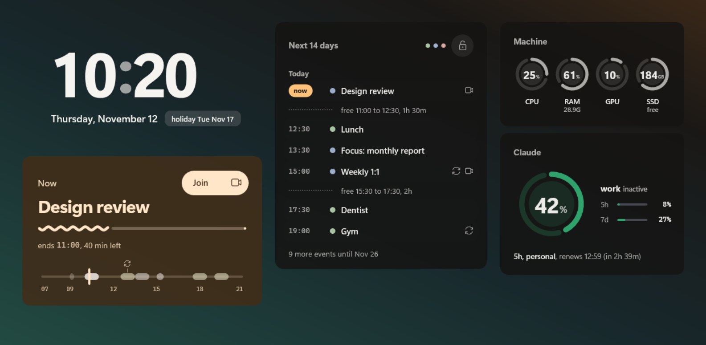

# Horizonte

A suite of five Rainmeter widgets for the Windows desktop that answers, at a glance:
what is next on my agenda, is my PC choking, and how much is left of my Claude quota.

[Português](README.pt-BR.md) · [Download the .rmskin](https://github.com/dosxnjos/horizonte/releases/latest) · [Rainmeter forum thread](https://forum.rainmeter.net/viewforum.php?f=130)

| Pistache | Crepúsculo (Dusk) |
| --- | --- |
|  |  |

The screenshots show the built-in **demo mode**: sample agenda and sample Claude usage, so the
suite looks alive the moment you install it.

## The widgets

| widget | what it shows |
| --- | --- |
| **Clock** (`Relogio`) | HH:MM with digits that roll only when they change, the date and a chip with the next holiday |
| **Day** (`Dia`) | a card that changes shape and color with its role: *Next, in 18 min*, *Now* (with a progress wave and a **Join** button for Meet/Teams links), *Free until 15:00*. Below it, a timeline of the day with a "now" needle and a mark where your Claude 5-hour window renews |
| **Agenda** | the next 14 days, grouped by day, with today's free gaps ("free 15:30 to 17:30, 2h"), daily series collapsed into one line ("Mon to Fri"), a health dot per calendar and a private mode (lock icon) that hides every title |
| **Machine** (`Maquina`) | CPU, RAM, GPU and drive rings (GB free). Neutral at rest, amber/red only when something needs attention, with hysteresis so they don't flicker. Hover shows the heaviest process; click opens Task Manager / Resource Monitor / Storage |
| **Claude** | a ring for the 5-hour window of the active account (same colors as the claude-usage-tray app) and 5h/7d bars for your other accounts |

Motion is short and only on change (rolling digits, sweeping rings, the Day card morphing).
At rest, nothing redraws: the whole suite costs about 2% of one CPU core and ~10 MB of RAM.

## Install

1. Install [Rainmeter](https://www.rainmeter.net/) 4.5 or newer.
2. Download `Horizonte_<version>.rmskin` from the [latest release](https://github.com/dosxnjos/horizonte/releases/latest) and double-click it.
3. The Clock loads by itself. Load the other four from the Rainmeter tray icon > **Skins** > **Horizonte**,
   or load all five at once from **Manage** > **Layouts** > **Horizonte** > **Load**
   (careful: loading a layout replaces the skins you have open now).
4. Drag each widget where you want it.

## Settings

Everything lives in one file: `Documents\Rainmeter\Skins\Horizonte\@Resources\Settings.inc`
(right-click a widget > **Edit skin** opens the folder). Instructions are inside, in English.
Save, then right-click > **Refresh skin**. Reinstalling or upgrading keeps your values.

| setting | values |
| --- | --- |
| `Idioma` | `en` English (default) or `pt` Portuguese (Brazil). Dates, labels, menus. Times are 24 h |
| `Demo` | `1` sample data (default) or `0` your real data |
| `Tema` | `expressivo` (solid tonal cards, default), `pistache` (the same in a light scheme), `crepusculo` ("Dusk": dark translucent cards with one amber accent, the clock floats over the wallpaper) |
| `Scale` | size multiplier, e.g. `1.25` |
| `Animacoes` | `1` transitions on, `0` off |
| `MaxItems` | how many events the Agenda lists before "N more events" |
| `Discos`, `RotuloDisco<letter>` | drives with their own ring (up to 3) and their labels |
| `ApelidoConta<N>` | nicknames for your Claude accounts |

## Real data (optional)

The clock and the Machine widget always show real values. The agenda and the Claude quota need a
data source; without one, the widgets say so and keep working.

- **Agenda.** The widgets never touch the network. They read `%LOCALAPPDATA%\Horizonte\agenda.json`,
  written every 10 minutes by `agenda_sync`, a small Python helper in this repo. It downloads your
  Google Calendars' private iCal addresses, expands recurring events (RRULE, EXDATE, moved
  occurrences) and keeps the private addresses in **Windows Credential Manager**, never in a file.
  Setup (needs [uv](https://docs.astral.sh/uv/)): clone this repo, run
  `powershell -NoProfile -File instalar.ps1` and then `uv run agenda-sync configurar`.
  Details (in Portuguese): [docs/agenda_sync.md](docs/agenda_sync.md); file format:
  [docs/CONTRATOS.md](docs/CONTRATOS.md).
- **Claude quota.** The widget only reads `%LOCALAPPDATA%\claude-usage-tray\snapshot.json`, written by
  the [claude-usage-tray](https://github.com/dosxnjos/claude-usage-tray) app. It never calls any API
  and never sees a token. `FonteClaude` points it at another file in the same format.

Then set `Demo=0` in `Settings.inc`.

## Requirements

- Windows 10 or 11, Rainmeter 4.5+ (no extra plugins).
- Fonts: Segoe UI Variable and Cascadia Mono (they come with Windows 11; on Windows 10 install
  Cascadia Mono and the Segoe UI Variable font from Microsoft, or the text falls back to Segoe UI).
- Optional: Python 3.14 + uv for the agenda helper; claude-usage-tray for the Claude widget.

## Privacy

No widget talks to the network. Calendar addresses live in Windows Credential Manager. Event
descriptions, guest lists and e-mails never reach the widgets (the helper strips them). Account
e-mails and organization names are never displayed. Private mode hides every title, also in tooltips.

## For developers

How each widget works, its variables and how to debug it: [docs/widgets.md](docs/widgets.md)
(Portuguese). Known pitfalls: [docs/ARMADILHAS.md](docs/ARMADILHAS.md). Build the installer with
`python tools/empacotar.py --versao 1.0.0`. Tests: `uv run pytest`.

## Credits

The first version of this widget was a mod of Enigma GCal (Kaelri) / eclectic-tech
(CC BY-NC-SA 3.0). Horizonte is a rewrite from scratch and reuses none of that code, but the idea
of merging several calendars into one list comes from there. JSON parsing: rxi/json.lua (MIT).

## License

[MIT](LICENSE)
