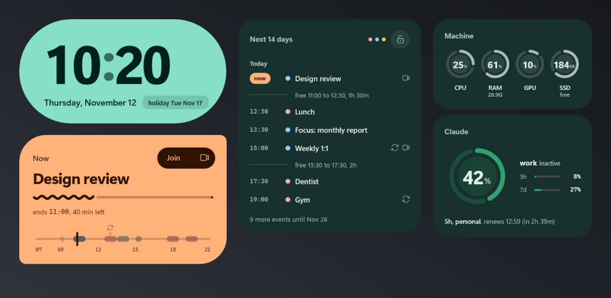
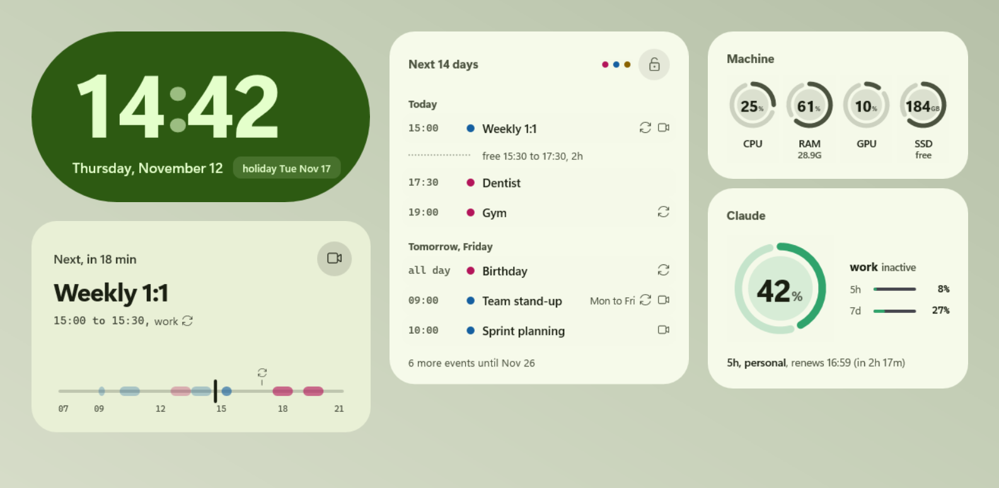
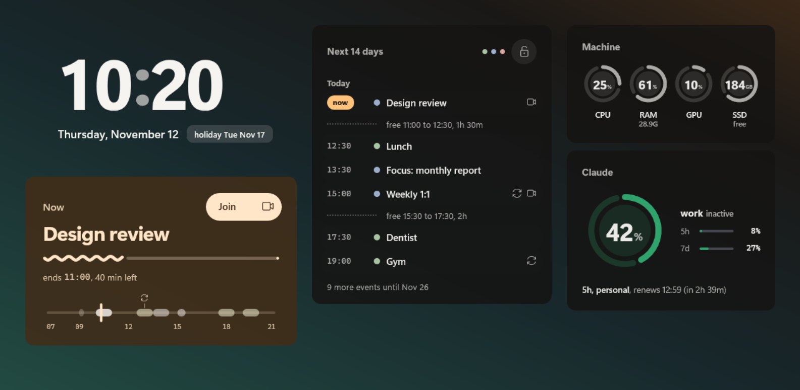

# Horizonte

Um pacote de cinco widgets do Rainmeter para o desktop do Windows que responde, numa olhada:
o que vem agora na agenda, se o PC está engasgando e quanto sobra da cota do Claude.

[English](README.md) · [Baixar o .rmskin](https://github.com/dosxnjos/horizonte/releases/latest) · [Tópico no fórum do Rainmeter](https://forum.rainmeter.net/viewforum.php?f=130)

| Pistache | Crepúsculo |
| --- | --- |
|  |  |

Os prints mostram o **modo demonstração**, que já vem ligado: agenda e cotas de exemplo, para o
pacote parecer vivo assim que é instalado.

## Os widgets

| widget | o que mostra |
| --- | --- |
| **Relógio** | HH:MM com dígitos que rolam só quando mudam, a data e um chip com o próximo feriado |
| **Dia** | um cartão que muda de forma e de cor conforme o papel: *Próximo, em 18 min*, *Agora* (com a onda de progresso e o botão **Entrar** para links do Meet ou Teams), *Livre até 15:00*. Embaixo, a linha do dia com a agulha do agora e a marca de quando renova a janela de 5 horas do Claude |
| **Agenda** | os próximos 14 dias agrupados por dia, os vãos livres de hoje ("livre 15:30 às 17:30, 2h"), séries diárias numa linha só ("seg a sex"), um ponto de saúde por agenda e o modo privado (cadeado), que esconde todos os títulos |
| **Máquina** | anéis de CPU, RAM, GPU e discos (GB livres). Neutros em repouso, âmbar ou vermelho só quando pedem atenção, com histerese para não piscar. O hover mostra o processo mais pesado; o clique abre o Gerenciador de Tarefas, o Monitor de Recursos ou o Armazenamento |
| **Claude** | o anel da janela de 5 horas da conta ativa (mesmas cores do app claude-usage-tray) e as barras 5h/7d das outras contas |

A animação é curta e só acontece quando algo muda. Parado, nada se redesenha: o pacote inteiro
custa uns 2% de um núcleo e uns 10 MB de RAM.

## Instalar

1. Instale o [Rainmeter](https://www.rainmeter.net/) 4.5 ou mais novo.
2. Baixe o `Horizonte_<versão>.rmskin` da [última release](https://github.com/dosxnjos/horizonte/releases/latest) e dê dois cliques.
3. O Relógio carrega sozinho. Carregue os outros quatro pelo ícone do Rainmeter > **Skins** > **Horizonte**,
   ou os cinco de uma vez em **Gerenciar** > **Layouts** > **Horizonte** > **Carregar**
   (atenção: carregar um layout troca as skins que estão abertas agora).
4. Arraste cada widget para onde quiser.

## Configurar

Tudo fica num arquivo só: `Documents\Rainmeter\Skins\Horizonte\@Resources\Settings.inc`. Salve e
clique com o botão direito no widget > **Atualizar skin**. Reinstalar mantém os seus valores.

| variável | valores |
| --- | --- |
| `Idioma` | `en` inglês (padrão do pacote) ou `pt` português. Datas, rótulos e menus. Hora em 24 h |
| `Demo` | `1` dados de exemplo (padrão) ou `0` os seus dados |
| `Tema` | `expressivo` (cartões chapados, padrão), `pistache` (o mesmo, claro), `crepusculo` (cartões escuros translúcidos com um acento âmbar, o relógio flutua sobre o papel de parede) |
| `Scale` | tamanho, por exemplo `1.25` |
| `Animacoes` | `1` com transições, `0` sem |
| `MaxItems` | quantos eventos a Agenda lista antes do "mais N eventos" |
| `Discos`, `RotuloDisco<letra>` | discos com anel próprio (até 3) e o nome de cada um |
| `ApelidoConta<N>` | apelidos das contas do Claude |

## Dados reais (opcional)

O relógio e a Máquina sempre mostram valores reais. A agenda e a cota do Claude precisam de uma
fonte; sem ela, o widget avisa e continua funcionando.

- **Agenda.** Os widgets nunca falam com a rede. Eles leem `%LOCALAPPDATA%\Horizonte\agenda.json`,
  que o `agenda_sync` (helper em Python deste repo) grava a cada 10 minutos. Ele baixa os endereços
  iCal secretos das suas agendas Google, expande os eventos recorrentes e guarda os endereços no
  **Gerenciador de Credenciais do Windows**, nunca em arquivo. Para ligar (precisa do
  [uv](https://docs.astral.sh/uv/)): clone o repo, rode `powershell -NoProfile -File instalar.ps1` e
  depois `uv run agenda-sync configurar`. Detalhes: [docs/agenda_sync.md](docs/agenda_sync.md).
- **Cota do Claude.** O widget só lê `%LOCALAPPDATA%\claude-usage-tray\snapshot.json`, gravado pelo app
  [claude-usage-tray](https://github.com/dosxnjos/claude-usage-tray). Ele nunca chama API nem vê token.

Depois, `Demo=0` no `Settings.inc`.

## Requisitos

- Windows 10 ou 11 e Rainmeter 4.5+ (sem plugin extra).
- Fontes Segoe UI Variable e Cascadia Mono (vêm com o Windows 11).
- Opcional: Python 3.14 + uv para a agenda; claude-usage-tray para o widget do Claude.

## Privacidade

Nenhum widget fala com a rede. Os endereços das agendas ficam no Gerenciador de Credenciais. A
descrição dos eventos, os convidados e os e-mails nunca chegam aos widgets. E-mail e organização das
contas do Claude nunca aparecem. O modo privado esconde todos os títulos, inclusive nos tooltips.

## Para quem desenvolve

Como cada widget funciona, variáveis e depuração: [docs/widgets.md](docs/widgets.md). O que já
mordeu: [docs/ARMADILHAS.md](docs/ARMADILHAS.md). Instalador: `python tools/empacotar.py --versao 1.0.0`.
Testes: `uv run pytest`.

## Créditos

A primeira versão deste widget era uma modificação do Enigma GCal (Kaelri) / eclectic-tech
(CC BY-NC-SA 3.0). O Horizonte é reescrito do zero e não reaproveita código dele, mas a ideia de
juntar várias agendas numa lista vem de lá. JSON: rxi/json.lua (MIT).

## Licença

[MIT](LICENSE)
